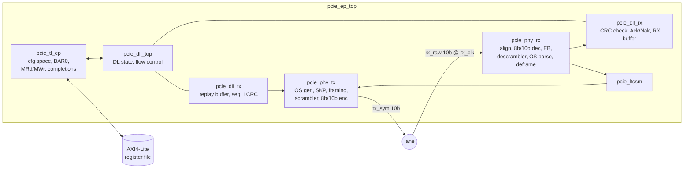
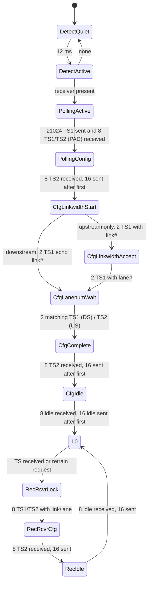

# Architecture

## 1. Block diagram



One symbol per 250 MHz clock (2.5 GT/s ÷ 10 bits). All layer-to-layer interfaces are byte streams with `valid/ready/sop/eop`.

## 2. Physical layer

### Transmit pipeline (`pcie_phy_tx`)

```
select symbol ─► scramble (stage 1) ─► 8b/10b encode (stage 2) ─► tx_sym
```

The selection priority each clock:

1. Continue the current ordered set (SKP = `COM SKP SKP SKP`, TS = 16 symbols).
2. Continue the current packet (payload, then `END`).
3. At a boundary: SKP ordered set if ≥ 1200 symbols since the last one.
4. At a boundary: TS1/TS2 if the LTSSM is training.
5. At a boundary: `STP`/`SDP` + DLL packet (L0 only).
6. Otherwise logical idle (`D0.0`, scrambled).

### Scrambler rules (identical on TX and RX)

| Symbol | LFSR | Data scrambled? |
|---|---|---|
| `COM` | reset to `FFFF` | no (K) |
| `SKP` | **not advanced** | no (K) |
| other K symbols | advance 8 | no |
| D symbols in TS1/TS2 | advance 8 | **no** |
| all other D symbols | advance 8 | yes |

Because SKPs never advance the LFSR, the elastic buffer can add or drop them without breaking descrambling.

### TS1 / TS2 ordered set

| Symbol | 0 | 1 | 2 | 3 | 4 | 5 | 6–15 |
|---|---|---|---|---|---|---|---|
| Content | COM | Link # or PAD | Lane # or PAD | N_FTS | Rate ID (0x02) | Training ctrl | D10.2 (TS1) / D5.2 (TS2) |

### Receive pipeline (`pcie_phy_rx`)

```
rx_clk domain:  rx_raw ─► comma align ─► 8b/10b decode ─► elastic buffer write
core   domain:  elastic buffer read ─► descramble ─► TS parser  ─► LTSSM
                                                  └► de-framer ─► DLL
```

The elastic buffer is a 32-entry async FIFO with Gray pointers. It starts reading at half full. The write side drops a SKP when it is too full, and the read side repeats a SKP when it is too empty.

### LTSSM (`pcie_ltssm`)



Every state has a timeout (2 / 24 / 48 ms) back to Detect.Quiet (not drawn).

How link and lane numbers are negotiated:

| Step | Downstream port (RC) sends | Upstream port (EP) sends |
|---|---|---|
| Linkwidth.Start | TS1(link = 0, lane = PAD) | TS1(PAD, PAD) |
| Linkwidth.Accept (EP) | – | TS1(link = 0, PAD) |
| Lanenum.Wait | TS1(0, 0) | TS1(0, 0) |
| Complete | TS2(0, 0) | TS2(0, 0) |

## 3. Data link layer

### Packet formats on the wire

```
TLP : STP | seq[11:8] | seq[7:0] | TLP header + payload ... | LCRC[7:0] .. LCRC[31:24] | END
DLLP: SDP | type | b1 | b2 | b3 | CRC[7:0] | CRC[15:8] | END
```

- **LCRC-32**: polynomial `04C11DB7`, reflected, seed `FFFFFFFF`, covers seq + TLP. Sent as `~crc`, low byte first (Ethernet CRC-32 arithmetic).
- **DLLP CRC-16**: polynomial `100B`, reflected (`D008`), seed `FFFF`. Sent as `~crc`, low byte first.

| DLLP | Byte 0 | Bytes 1–3 |
|---|---|---|
| Ack / Nak | `00` / `10` | `00`, `{0, seq[11:8]}`, `seq[7:0]` |
| InitFC1 P/NP/Cpl | `40` / `50` / `60` | `{00, HdrFC[7:2]}`, `{HdrFC[1:0], 00, DataFC[11:8]}`, `DataFC[7:0]` |
| InitFC2 P/NP/Cpl | `C0` / `D0` / `E0` | same |
| UpdateFC P/NP/Cpl | `80` / `90` / `A0` | same |

### Transmit side (`pcie_dll_tx`)

- **Ingest:** A TLP from the TL is accepted only when (a) DL_Active, (b) the partner has enough credits for its FC class, and (c) the replay buffer has room. It is written to the replay buffer as `seq, TLP, LCRC`, and an entry `{start, length, seq}` is pushed.
- **Transmit:** `e_tx` walks entries between `e_rd` (oldest un-acked) and `e_wr`.
- **Ack(seq):** Purge entries with `entry.seq ≤ seq` (mod 4096), reset REPLAY_NUM and the replay timer.
- **Nak(seq):** Purge as for Ack, then replay: `e_tx ← e_rd`.
- **Replay timer:** Runs while un-acked TLPs exist in L0. On expiry, it replays.
- **REPLAY_NUM:** Rolls over after 4 replays without progress. It then pulses `retrain_req` and the LTSSM goes to Recovery.
- **DLLP priority:** Ack/Nak > InitFC (in DL_Init) > UpdateFC > TLP.

### Receive side (`pcie_dll_rx`)

A 4-byte delay line holds back the last four bytes of a TLP (its LCRC). Bytes leaving the delay line are CRC'd and written to the receive buffer at a *tentative* pointer. At `END`:

| Condition | Action |
|---|---|
| LCRC good, seq = NEXT_RCV_SEQ | commit to buffer, NEXT_RCV_SEQ++, send Ack |
| LCRC good, seq already received | discard, Ack(NEXT_RCV_SEQ − 1) |
| bad LCRC / framing / future seq | discard, Nak(NEXT_RCV_SEQ − 1), only once until a good TLP arrives |
| ended with EDB (nullified) | discard silently |

When the TL has read a whole TLP from the buffer, its credits are returned: CREDITS_ALLOCATED += (1 header, ⌈len/4⌉ data), and an UpdateFC is scheduled.

### Flow control

| Class | Endpoint advertises | Root-complex model advertises |
|---|---|---|
| Posted (MWr, Msg) | 8 hdr / 64 data (1 KB) | 16 / 128 |
| Non-posted (MRd, Cfg) | 8 / 8 | 16 / 16 |
| Completion | infinite (0/0) | infinite |

The transmitter gate is the spec formula: `(CREDIT_LIMIT − (CONSUMED + needed)) mod 2^N ≤ 2^(N−1)`.

## 4. Transaction layer (`pcie_tl_ep`)

One TLP at a time:

```
S_HDR ─► S_DECODE ─┬─ MWr hit ─► S_WDATA ⇄ S_AXI_W ─────────────► S_HDR
                   ├─ MRd     ─► S_RD_START ─► S_AXI_R (xN) ─► S_CPL
                   ├─ CfgRd0  ─► S_CFGR ───────────────────────► S_CPL
                   ├─ CfgWr0  ─► S_CFGW_DATA ─► S_CFGW ────────► S_CPL
                   ├─ other NP ─► UR ──────────────────────────► S_CPL
                   └─ other P / Cpl ─► drop
```

Completion Byte Count for MRd: 1 DW → from First BE. Multi-DW → `4·len − (skipped low bytes of First BE) − (skipped high bytes of Last BE)`. Lower Address = `{addr[6:2], first enabled byte}`.

### Configuration space map

| Offset | Register | Value / behaviour |
|---|---|---|
| 0x00 | Device ID / Vendor ID | parameters |
| 0x04 | Status / Command | Status bit 4 = cap list. Command RW: mem, bus master, parity, SERR, INTx disable |
| 0x08 | Class / Revision | `CLASS_CODE` (default 0x120000 processing accelerator) |
| 0x10 | BAR0 | 32-bit non-prefetchable memory, size 2^BAR0_BITS |
| 0x34 | Cap pointer | 0x40 |
| 0x40 | PM capability | ID 01, next 0x60 |
| 0x60 | PCIe capability | ID 10h, v2, endpoint, next 0 |
| 0x64 | Device Cap | MPS 128 B |
| 0x6C | Link Cap | 2.5 GT/s, x1 |
| 0x70 | Link Status | 2.5 GT/s, x1 |

## 5. Test bench

```
          rc_clk (249.875 MHz)                         ep_clk (250 MHz)
+---------------------------+   pcie_channel  +---------------------------+
| pcie_rc_bfm               |---------------->| pcie_ep_top               |
|  PHY (DOWNSTREAM=1) + DLL |  offset 3 bits  |                           |--AXI--> axil_regfile
|  + cfg_rd/cfg_wr/mem_rd/  |<----------------|                           |
|    mem_wr tasks           |  offset 7 bits  +---------------------------+
+---------------------------+
```

`pcie_channel` delays the words, shifts the word boundary by N bits (so comma alignment is exercised) and can flip bits (`err_inject`).

## 6. Moving to hardware (U55C, later)

1. Configure a GTY channel: 2.5 Gb/s with a 10-bit user data width (a 20-bit width needs a small 2:1 gearbox). **Disable** the transceiver's 8b/10b and comma alignment (this design does both). Use the 100 MHz PCIe REFCLK.
2. Use RXOUTCLK as `rx_clk` and a 250 MHz TXUSRCLK as `clk`.
3. Receiver detection: GTY has `TXDETECTRX`. Drive `rx_present` from its result, or tie it to 1 initially.
4. Electrical idle: drive `TXELECIDLE` from `tx_eidle`.
5. Hold `rst` while PERST# is asserted.
6. Only lane 0 is driven. The host's receiver detection finds a single lane and trains x1.
7. Add an ILA on `ltssm_state`, `dl_up` and the `stat_*` counters.
